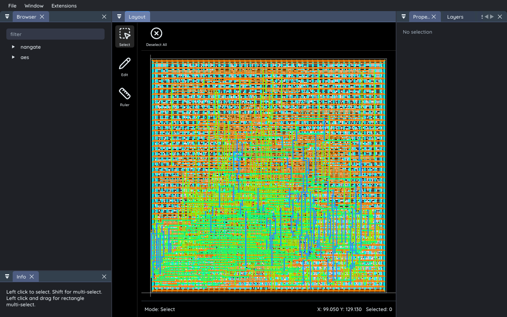

# Layout Engine

```
┌┐    ┌┬──┐ ┌┐ ┌┐ ┌┬──┐ ┌┐  ┐ ┌─┬┬─┐      ┌┬──┐ ┌┬─┐ ┐ ┌┬──  ┌┐ ┌┬─┐ ┐ ┌┬──┐
├┤    ├┼──┤ └┴─┼┤ ├┤  │ ├┤  │   ├┤        ├┼─   ├┤ │ │ ├┤ ┬┐ ├┤ ├┤ │ │ ├┼─
└┴──┘ └┘  ┘ └──┴┘ └┴──┘ └┴──┘   └┘        └┴──┘ └┘ └─┘ └┴─┴┘ └┘ └┘ └─┘ └┴──┘
```

An IC layout tool for Linux servers: it reads LEF/DEF and SystemVerilog
into one in-memory database, and you view and edit it from a Tcl shell and
a GUI. It's built for hierarchical designs with millions of objects, on
machines with plenty of CPU and memory and little or no GPU.



## Features

- **Your design files, in one database.** LEF and DEF (technology,
  abstracts, placement, routing), and SystemVerilog/Verilog netlists and
  RTL through the [slang](https://github.com/MikePopoloski/slang) frontend,
  linked into one model of libraries, designs and their abstract, layout
  and schematic views. Written back out as LEF and DEF, or saved whole in a
  compact native `.led` file that newer versions migrate on load.
- **Fast on large designs, without a GPU.** A compact object-pool database,
  routing stored as packed wires, and a multithreaded render pipeline that
  resolves each placed cell once, culls to the viewport, and re-renders
  only what an edit touched. Drawing is done on the CPU, so the GUI needs
  no GPU: Mesa's software rendering is enough.
- **A scriptable Tcl shell.** `le_shell` gives every object in the database
  `get_`, `create_`, `update_` and `delete_` commands, with `-filter`
  expressions and property paths, all in microns. Edits are undoable, and
  `help` and `man` document every command.
- **A GUI that stays out of the shell's way.** A dockable Dear ImGui window,
  opened from the shell with `show_gui`: browse libraries and designs, show
  and hide layers and purposes, select, move and resize shapes and
  placements, measure with rulers and trace net flightlines.
- **Extensions.** Add Tcl commands, C++ code, GUI windows and menus, drawing
  overlays, and your own database classes with migrations, through a
  versioned SDK.
- **`le`, the package manager.** It assembles a project's extensions from
  GitHub, checking each against SSH signatures you trust, and either runs a
  signed release or builds from source. `le toolchain` provides the whole
  build toolchain, without root or system compilers.

## Getting started

- **Run a release.** Download a signed bundle from
  [GitHub Releases](../../releases), unpack it anywhere and run `le_shell`.
  It needs no build tools.
- **Build from source.** See [docs/BUILD.md](docs/BUILD.md): with `le`, with
  the conda-forge toolchain and no root, or with your system's packages.
- **Add extensions.** Start an `le` project; see
  [tools/le/README.md](tools/le/README.md).

```
$ le_shell
le_shell > read_lef -library tech tech.lef
le_shell > read_def -library chip chip.def
le_shell > open_design top -view layout
le_shell > show_gui
```

## Documentation

- [docs/BUILD.md](docs/BUILD.md): building from source and running the
  bundle.
- [docs/TCL_COMMANDS.md](docs/TCL_COMMANDS.md): every Tcl command, by
  section.
- [docs/EXTENSION_SDK.md](docs/EXTENSION_SDK.md): writing extensions, and
  the API changelog.
- [tools/le/README.md](tools/le/README.md): the `le` package manager.
- [docs/RELEASING.md](docs/RELEASING.md): making and verifying signed
  releases.
